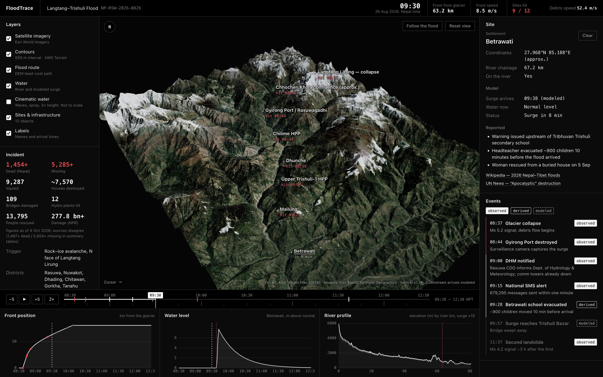
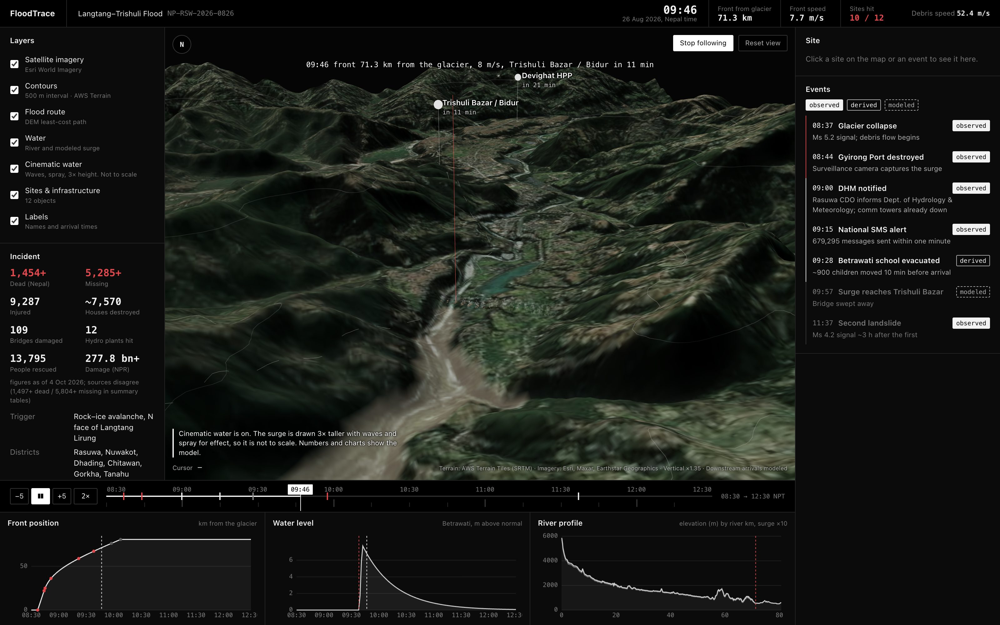

# FloodTrace

A 3D reconstruction of the 26 August 2026 Langtang–Trishuli flood in Nepal. Real terrain, real imagery, and a flood model calibrated to the one travel time anyone observed.

**[Live site](https://floodtrace-delta.vercel.app)** · **[Open the dashboard](https://floodtrace-delta.vercel.app/app/)** · [How it was built](docs/APPROACH.md) · [Roadmap](docs/ROADMAP.md)



[](LICENSE)


## What happened

At 08:37 Nepal time a block of rock and ice fell from the north face of Langtang Lirung. Seven minutes later a surveillance camera recorded the surge destroying the Gyirong border crossing. The flood ran down the Bhote Koshi and Trishuli past Syafrubesi, Mailung and Betrawati to Trishuli Bazar. At least 1,454 people died in Nepal and more than 5,000 are missing ([Wikipedia](https://en.wikipedia.org/wiki/2026_Nepal%E2%80%93Tibet_floods), [UNDP](https://www.undp.org/asia-pacific/nepal-floods-2026)).

## What the dashboard does

- **Scrub the morning.** A timeline from 08:30 to 12:30 drives the map, the event log and three charts: front position, water level at a site, and the river profile.
- **Inspect a site.** Click Betrawati, Upper Trishuli-1 or any of the 12 sites to see its modeled arrival, the current water level and the reported facts with sources.
- **Follow the flood.** The camera starts on the glacier and chases the wave front 80 km down the valley. Playback paces itself so the surge crosses the screen at a steady speed.
- **Cinematic water.** An optional layer adds rolling waves, spray and a breaking front for presentations. It draws the surge 3× taller and says so on screen. The numbers stay modeled.



## Real vs modeled

Every time in the app carries a label.

| Label | Meaning | Examples |
| --- | --- | --- |
| `observed` | Reported by people or instruments | 08:37 seismic signal, 08:44 Gyirong camera, 09:15 SMS alert, casualty figures |
| `derived` | Calculated from observations | 52.4 m/s debris speed, Betrawati evacuation 10 min before arrival |
| `modeled` | Produced by the model | Arrival times below Gyirong, surge height, flood width |

Site positions are approximate to 1–2 km. The river route is computed from the elevation data, not surveyed. Treat downstream times as a reconstruction, not a record. This is not a forecasting or warning tool.

## How it works

1. **Terrain.** 12 AWS Terrain tiles (zoom 11) and 192 Esri World Imagery tiles (zoom 13) load in the browser and become a 768 × 1024 vertex mesh with shadows.
2. **Route.** Dijkstra over the elevation grid, with a cost that grows with the cube of height, chained through the known settlements. That gives an 80.7 km river with a distance at every point.
3. **Flood front.** Two phases. Collapse to Gyirong runs at the constant speed implied by the observed 7 minutes. Below Gyirong the speed decays toward a 7 m/s flood wave, an assumption based on the 2021 Chamoli flood.
4. **Water.** Cross-sections every 60 m carry a water sheet at bed level plus surge height. The terrain hides it wherever the ground is higher, so the flood edge follows the real valley walls. A silt mark stays on the slopes after the surge passes.

The full write-up, including what went wrong along the way, is in [docs/APPROACH.md](docs/APPROACH.md).

## Run it locally

```bash
git clone https://github.com/anudeepadi/floodtrace.git
cd floodtrace
npm install
npm run dev        # landing page at /, dashboard at /app/
npm test           # 60 unit tests for the geo, model and data modules
npm run build
```

Map tiles load from AWS and Esri at runtime, so you need a network connection. No API keys.

## Project layout

```
index.html            landing page
app/index.html        dashboard
src/
  data/incident.ts    sites, events, figures and their sources
  geo/                Web Mercator, heightfield, least-cost route, valley corridor
  sim/                flood front model, follow-camera pacing, cinematic heights
  scene/              terrain, water shaders, spray, markers, viewer
  ui/                 panels, timeline, charts
docs/                 approach, roadmap, launch drafts
experiments/          the wildfire prototype this started from
```

## Data and credits

- Terrain: [AWS Terrain Tiles](https://registry.opendata.aws/terrain-tiles/) (SRTM, GMTED and others)
- Imagery: Esri World Imagery (Esri, Maxar, Earthstar Geographics)
- Incident facts: Wikipedia, UNDP, UN News and Britannica, cited per item in the app
- Inspired by [Dilum Sanjaya's wildfire analysis demo](https://x.com/DilumSanjaya), which used procedural terrain. FloodTrace started as a copy of that idea and moved to real data.

Built by [Anudeep Adiraju](https://www.heyadi.dev) with Claude Code.

## License

[MIT](LICENSE). Imagery and terrain remain under their providers' terms.
